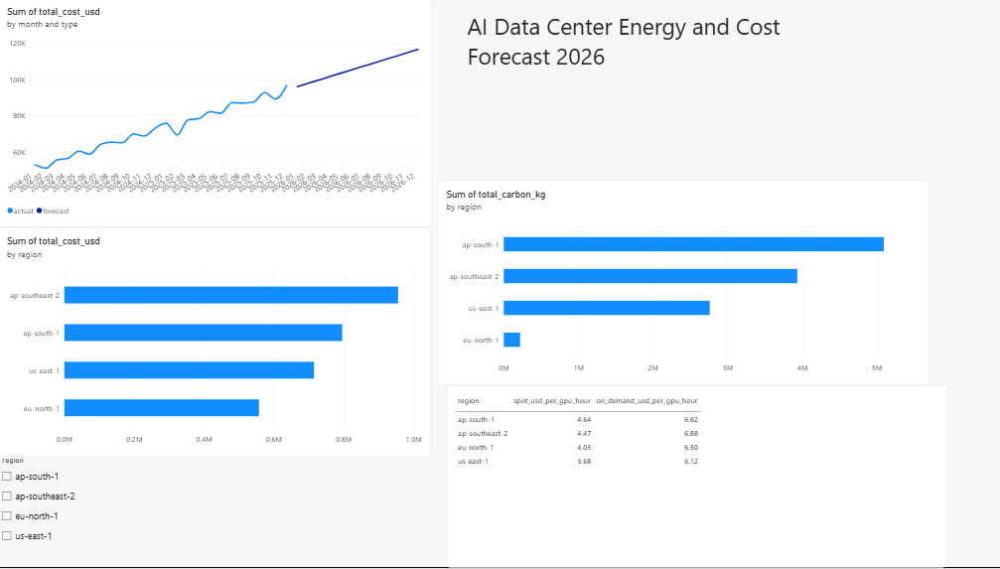

# AI Data Center Energy and Cost Forecasting (2026)

Forecast monthly **energy, cost and carbon** for GPU workloads in 2026 and recommend the **cheapest** and **greenest** AWS region to run them. Built on AWS (S3, Athena, SageMaker) with a Power BI dashboard.



## Problem
AI workloads are driving fast growth in data center electricity demand. Teams struggle to predict power use, cloud cost and carbon impact, and to choose where to run GPU jobs.

## Key results
| Insight | Result |
|---|---|
| Monthly cost (all regions) | about 53K USD (Jan 2024) to about 97K (Dec 2025), forecast about 117K (Dec 2026) |
| Cheapest GPU (spot) | **us-east-1**, $3.68 per GPU-hour |
| Greenest and lowest energy cost | **eu-north-1**, 30 gCO2/kWh vs 700 in ap-south-1 |

## Architecture
```
Sources (OWID energy, simulated GPU logs, pricing)
   -> S3 raw -> Athena (SQL cleaning) -> S3 processed (Parquet)
   -> SageMaker (trend forecast) -> S3 results -> Power BI dashboard
```

## Repository structure
```
src/         data generators (GPU usage, cloud pricing)
sql/         Athena table and analysis queries
notebooks/   forecast code for SageMaker
data/        cloud_pricing.csv (gpu_usage.csv is generated)
docs/        dashboard screenshot, DAX measures, presentation
```

## How to reproduce
1. **Generate data:** `pip install -r requirements.txt`, then `python src/generate_gpu_data.py` and `python src/generate_pricing.py`.
2. **Upload to S3:** put `gpu_usage.csv` in `raw/gpu_usage/` and `cloud_pricing.csv` in `raw/pricing/` (also `raw/energy/` for the OWID file).
3. **Athena:** create database `ai_energy_db`, then run `sql/01` to `sql/03` in order (replace `YOUR-BUCKET-NAME`). Set the query result location to `s3://YOUR-BUCKET-NAME/athena-results/`.
4. **Forecast:** run `notebooks/forecast.py` in a SageMaker notebook (set `BUCKET`). It writes `processed/forecast/forecast_results.csv`.
5. **Dashboard:** load `forecast_results.csv` and `cloud_pricing.csv` into Power BI and add the measures from `docs/powerbi_measures.dax`.

Region used: `ap-southeast-2` (Sydney).

## Data sources and honesty notes
- **GPU usage** is **simulated** from realistic assumptions (about 0.7 kW per GPU, PUE 1.3, regional prices and carbon intensity). Real operator logs are not public.
- **Cloud prices** are **illustrative**, not official AWS quotes.
- **Energy context:** [Our World in Data energy dataset](https://github.com/owid/energy-data).

## Limitations
- Linear trend forecast only, with no seasonality.
- The Glue crawler was blocked by an account restriction, so tables were created manually in Athena.
- Power BI reads downloaded CSVs, not a live S3 connection.

## Future work
Time-of-day "cheapest hour to run" analysis, Prophet or SageMaker DeepAR for seasonality, live prices from the AWS Pricing API, and a live Athena connection in Power BI.

## Cost note
S3 and Athena cost almost nothing at this scale. Stop SageMaker notebooks after use.

## License
MIT
